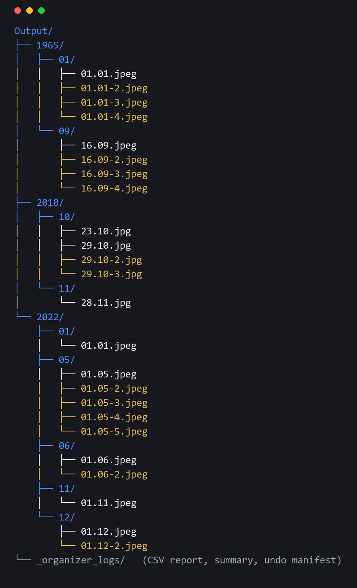

# 📷 Media Organizer

A Windows desktop app and command-line tool for sorting photos and videos into a clean
**`YYYY / MM / DD.MM.ext`** library — now with **multi-folder scanning** and
**AI person / face search** (upload a photo of someone, and it finds and organizes every
photo & video of them across all the folders you specify).

Full Unicode / Hebrew path support, deterministic naming, collision-safe, and one-click Undo.


## ✨ Features

- **Paste-and-go dark-mode GUI** (`MediaOrganizer.exe`) + scriptable **CLI** (`MediaOrganizer-cli.exe`), both shipped as standalone `.exe` files with zero dependencies.
- **Multi-folder scanning:** paste one or more folder paths (one per line, or add folders with the button) to search and organize across multiple drives/directories at once.
- **Person / Face Search (optional):** upload a reference photo of a person (`--person` in CLI or **העלה תמונת אדם** in GUI). Uses OpenCV **YuNet + SFace** ONNX models (bundled inside the `.exe`, runs 100% offline) to detect and match that person across all images (including rotated/HEIC) and sampled video frames.
- **Smart date detection** with a strict fallback priority:
  1. **Metadata:** EXIF `DateTimeOriginal` → `CreateDate` (DateTimeDigitized) → `DateTime`;
     videos use ffprobe `creation_time` (if installed), otherwise MP4/MOV `mvhd`/`mdhd` atoms natively.
  2. **Filename:** `20020201_101112`, `IMG-20020201-WA0003`, `2002-02-01`, `01.02.2002`,
     `16.9.65`, `02-2023`, `12.2021`, `03-19`, `5.19`, Hebrew/English month names
     (`יולי 2015`, `July 2015`, typo-tolerant e.g. `פבואר 2016`), and bare years (`1965`, `סביב 1965`).
     Generic camera names like `IMG_2812.JPG`, `DSCF7114.JPG`, `scan0012.jpg` are **never** treated as dates.
  3. **Filesystem:** the earliest of `st_ctime` and `st_mtime`.
- **Folder structure:** `<Output>/<YYYY>/<MM>/DD.MM.ext`. Extensions are preserved in lower case.
- **Same-date collisions:** `01.02.jpg`, `01.02-2.jpg`, `01.02-3.jpg`, … in deterministic order.
- **Duplicates:** byte-identical files (SHA-256) are detected among inputs and against existing output files, skipped and logged by default (or kept with `--keep-duplicates`).
- **Safe by default:** **Copy** mode by default, SHA-256 verification of every copy, never overwrites, CSV/text reports in `_organizer_logs/`, and one-click **Undo**.

## 🗂️ Output structure



## 🚀 Download & run

Download [`dist/MediaOrganizer.exe`](dist/MediaOrganizer.exe) (GUI) or [`dist/MediaOrganizer-cli.exe`](dist/MediaOrganizer-cli.exe) (CLI), or grab them from the [latest release](../../releases/latest). No Python or external tools needed.

### GUI

1. **Paste** one or more source folder paths (or click **➕ הוסף תיקייה**).
2. *(Optional)* **Upload a person's photo** (**🖼️ העלה תמונת אדם…**) to filter only photos/videos containing their face.
3. Click **✨ סדר הכל** — everything is organized into `<Output>/YYYY/MM/DD.MM.ext`.

### CLI

```powershell
# Dry-run preview
MediaOrganizer-cli.exe "D:\Phone dump" "D:\Photos"

# Search across multiple folders for a specific person and organize matches
MediaOrganizer-cli.exe "D:\Photos" "E:\Backups" --out "D:\Grandpa_Photos" --person "C:\ref.jpg" --run

# Move only 2000–2005
MediaOrganizer-cli.exe "D:\Scans" "D:\Photos" --run --move --year-from 2000 --year-to 2005

# Revert the most recent run
MediaOrganizer-cli.exe --undo "D:\Photos"
```

## ✅ Verified

- **35 unit tests** (`pytest`) passing, covering Hebrew paths, EXIF/MP4/filename/filesystem priority, collisions, duplicates, multi-source scanning, face filtering, move + undo.
- **Real-folder verification** on `סבא חוגג 90` (148 photos):
  - Full organize: 146 unique photos organized across 30 years (1965–2026), 2 byte-identical duplicates skipped, 0 missing hashes.
  - Person face search (`05-2018-2.jpeg` reference): matched 37 photos of that person out of 148.

## 🛠️ Build from source

```powershell
git clone https://github.com/dor2500/media-organizer
cd media-organizer
python -m venv .venv
.\.venv\Scripts\pip install -r requirements-dev.txt
.\.venv\Scripts\python -m pytest
.\build.ps1   # builds dist\MediaOrganizer.exe & dist\MediaOrganizer-cli.exe
```

## License

MIT
