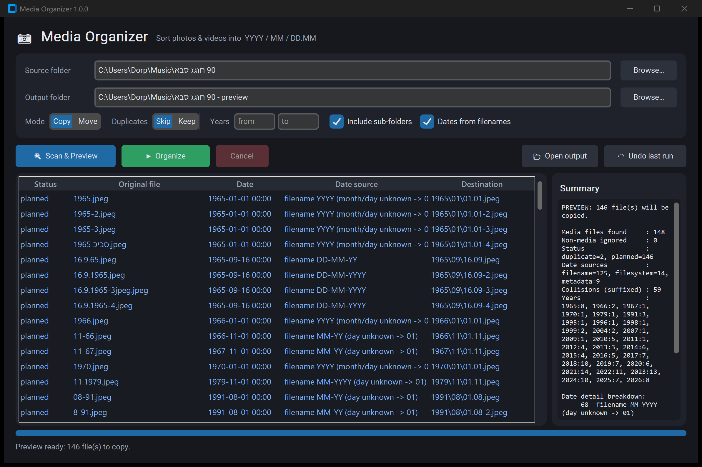

# 📷 Media Organizer

A dependable Windows desktop app and command-line tool for sorting photos and videos into a
clean **`YYYY / MM / DD.MM.ext`** library. It works out every file's date from
**EXIF/video metadata → filename → filesystem**, never overwrites or loses a file, and logs
exactly what it did and why. Full Unicode/Hebrew path support.



## ✨ Features

- **Dark-mode GUI** (CustomTkinter) plus a scriptable **CLI**, both shipped as standalone `.exe` files.
- **Smart date detection** with a strict fallback priority:
  1. **Metadata:** EXIF `DateTimeOriginal` → `CreateDate` (DateTimeDigitized) → `DateTime`;
     videos use ffprobe `creation_time` (if installed), otherwise the MP4/MOV `mvhd`/`mdhd`
     atoms (`CreateDate` / `MediaCreateDate`), which are parsed natively.
  2. **Filename:** `20020201_101112`, `IMG-20020201-WA0003`, `2002-02-01`, `01.02.2002`,
     `16.9.65`, `02-2023`, `12.2021`, `03-19`, `5.19`, Hebrew/English month names
     (`יולי 2015`, `July 2015`, typo-tolerant, so `פבואר 2016` is still read as February),
     and bare years (`1965`, `סביב 1965`).
     Generic camera names like `IMG_2812.JPG`, `DSCF7114.JPG` and `scan0012.jpg` are **never** treated as dates.
  3. **Filesystem:** the earliest of `st_ctime` (creation time on Windows) and `st_mtime`.
- **Folder structure:** `<Output>/<YYYY>/<MM>/DD.MM.ext`. Extensions are kept, in lower case.
- **Same-date collisions:** `01.02.jpg`, `01.02-2.jpg`, `01.02-3.jpg`, … in a **deterministic**
  order (by date, then natural filename order), so re-runs always give identical results.
- **Duplicates:** byte-identical files (SHA-256) are detected among the inputs *and* against
  files already in the output. They are skipped and logged by default, or kept with
  `--keep-duplicates` / the *Keep* toggle. Re-running on the same output adds nothing new.
- **Safe by default:** dry-run preview, **copy** mode (move is opt-in), SHA-256 verification
  of every copy, never overwrites, and a one-click **Undo** from a JSON manifest.
- **Year-range filter** (e.g. 2000–2005) for batch sorting a slice of a library.
- **Reports:** every preview or run writes `_organizer_logs/` containing a CSV (UTF-8 BOM, so
  it opens cleanly in Excel with Hebrew), a text summary and an undo manifest.
- **Formats:** JPG/JPEG, PNG, HEIC/HEIF, WEBP, TIFF, GIF, BMP, RAW (DNG, CR2, CR3, NEF, ARW, …),
  MP4, MOV, M4V, 3GP, AVI, MKV, MTS, WMV, WEBM, …

## 🗂️ Output structure


Yellow entries are same-date collisions that got a sequential suffix.

## 🚀 Download & run

Grab the executables from [`dist/`](dist/) or the
[latest release](../../releases/latest). Nothing needs to be installed.

| File | Purpose |
|------|---------|
| `MediaOrganizer.exe` | Desktop GUI |
| `MediaOrganizer-cli.exe` | Command line (also handy for scripting / Task Scheduler) |

> Windows SmartScreen may warn about an unsigned executable. Choose *More info → Run anyway*.

### GUI

1. Pick a **Source folder** and an **Output folder** (the output defaults to `<source> - organized`).
2. Choose **Copy/Move**, **Skip/Keep** duplicates, and optionally a year range.
3. Click **Scan & Preview** and review the table (status, resolved date, date source, destination).
4. Click **Organize**. **Undo last run** reverts it.

### CLI

```powershell
# Dry-run preview (changes nothing except writing a report into <output>\_organizer_logs)
MediaOrganizer-cli.exe "D:\Phone dump" "D:\Photos"

# Copy for real, listing every mapping
MediaOrganizer-cli.exe "D:\Phone dump" "D:\Photos" --run --list

# Move only 2000–2005
MediaOrganizer-cli.exe "D:\Scans" "D:\Photos" --run --move --year-from 2000 --year-to 2005

# Revert the most recent run in an output folder
MediaOrganizer-cli.exe --undo "D:\Photos"
```

| Option | Meaning |
|--------|---------|
| `--run` | Perform the operation (otherwise dry-run) |
| `--move` | Move instead of copy |
| `--year-from / --year-to` | Only include files in this year range |
| `--keep-duplicates` | Keep byte-identical files (suffixed) instead of skipping |
| `--no-filename-dates` | Ignore dates in filenames (metadata → filesystem only) |
| `--no-recursive` | Don't scan sub-folders |
| `--no-verify` | Skip SHA-256 verification of copies |
| `--list` | Print every source → destination mapping |
| `--undo DIR` | Revert the last run recorded in `DIR\_organizer_logs` |

## ✅ Verified on a real folder

Tested against a real family-photo folder with a Hebrew path (`…\Music\סבא חוגג 90`, 148 scanned and
camera photos):

```
Media files found     : 148
Status                : done=146, duplicate=2
Date sources          : filename=125, filesystem=14, metadata=9
Collisions (suffixed) : 59
Years                 : 1965 … 2026 (30 distinct years)

Date detail breakdown:
     68  filename MM-YYYY (day unknown -> 01)
     38  filename MM-YY (day unknown -> 01)
     14  st_mtime
      9  filename YYYY (month/day unknown -> 01.01)
      9  EXIF DateTimeOriginal
      5  filename month-name YYYY (day unknown -> 01)
      4  filename DD-MM-YYYY
      1  filename DD-MM-YY
```

An independent SHA-256 check confirmed that **every unique source file exists in the output**
(146 unique hashes in, 146 out). The 2 skipped files were byte-identical copies of other photos.

### Edge cases and how they're handled

| Case | Behaviour |
|------|-----------|
| Month-only name (`02-2023.jpeg`) | Day taken from the filesystem date if it's in the same month, otherwise `01` (logged as "day unknown") |
| Year-only name (`1965.jpeg`) | `1965/01/01.01.jpeg`, logged as "month/day unknown" |
| Day/month without a year (`16-10.jpeg`) | Too ambiguous, so it falls back to the filesystem date |
| No usable info (`לא ידוע.jpeg`, `IMG_2812` without EXIF) | Filesystem date |
| This tool's own output names (`01.02-12.jpg`) | Never mis-read as dates when re-organizing |
| Output folder inside the source | Automatically excluded from scanning |
| Target name appears mid-run | Next free suffix is used; nothing is overwritten |

## 🛠️ Build from source

```powershell
git clone https://github.com/dor2500/media-organizer
cd media-organizer
python -m venv .venv
.\.venv\Scripts\pip install -r requirements-dev.txt
.\.venv\Scripts\python -m pytest            # 32 tests, including Hebrew paths
.\.venv\Scripts\python -m media_organizer   # GUI (pass arguments for CLI)
.\build.ps1                                 # -> dist\MediaOrganizer.exe, dist\MediaOrganizer-cli.exe
```

### Project layout

```
media_organizer/
  dates.py   date extraction (EXIF, MP4 atoms, ffprobe, filename patterns, filesystem)
  core.py    scan -> plan (naming, collisions, duplicates) -> execute -> reports / undo
  cli.py     command-line interface
  gui.py     CustomTkinter dark GUI
tests/       pytest suite
tools/       icon + docs image generators
build.ps1    PyInstaller build script
```

## License

MIT
